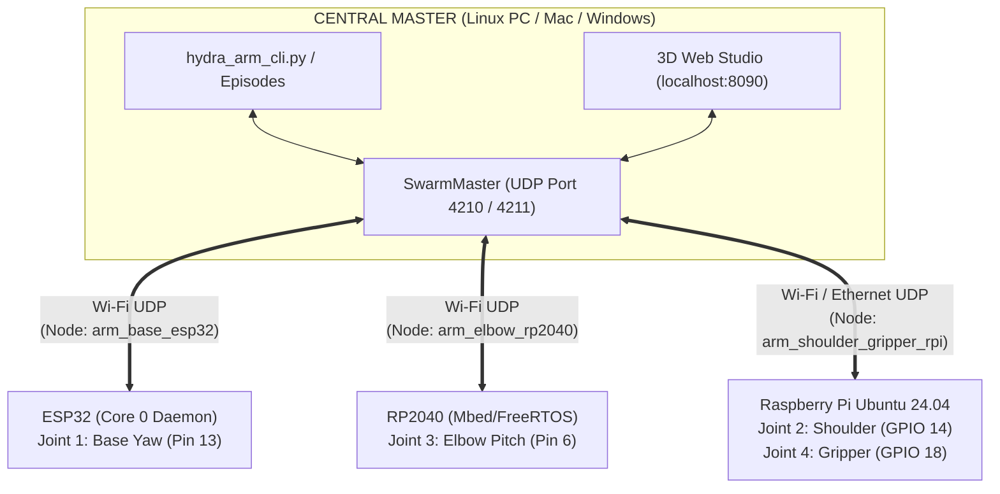

# OpenSwarm HydraArm — Multi-Controller Distributed Robotic Arm

<p align="center">
  <a href="https://pypi.org/project/openswarm-master/"></a>
  <a href="https://pypi.org/project/openswarm-slave/"></a>
  <a href="https://github.com/raihhann/OpenSwarm"></a>
  
  
</p>

---

## What is HydraArm?

**HydraArm** is a 4-DOF distributed robotic arm that showcases the power of the **[OpenSwarm](https://github.com/raihhann/OpenSwarm)** Distributed Remote Hardware Abstraction Layer (Remote HAL):

* **Multi-Architecture Control:** Rather than wiring all 4 motors to a single microcontroller or running heavy ROS nodes on an SBC, HydraArm's 4 servo joints are distributed across **3 completely different hardware architectures** operating together over Wi-Fi:
  1. **ESP32** (32-bit Xtensa dual-core) &rarr; Base Yaw Servo
  2. **RP2040** (Raspberry Pi Pico W / Nano RP2040 Connect, dual ARM Cortex-M0+) &rarr; Elbow Pitch Servo
  3. **Raspberry Pi 4 / 5** (Quad ARM Cortex-A72/A76 running Ubuntu 24.04 LTS) &rarr; Shoulder Pitch & Gripper Servos
* **Zero Slave Control Logic:** Every slave microcontroller runs **0% control logic** (`void loop()` is 100% empty). Firmware simply declares the servo pin once in `setup()` and lets OpenSwarm's background daemon handle discovery, UDP telemetry streaming, and scheduled pulse updates.
* **Central Python Master with 3D Digital Twin:** 100% of trajectory planning, joint constraints, episode playback, and network synchronization live in Python on the Master. Control the arm via a command-line terminal or an interactive **3D Digital Twin Web Studio** where clicking any joint on the 3D model opens a slider to actuate the physical robot in real time.

> [!NOTE]
> **Provenance & Physical Design:**  
> The 3D printable mechanical structure of this robot is based on the [**Servo Mini Arm by Luca Dilo**](https://makerworld.com/en/models/1290483-servo-mini-arm), designed for four SG90 / MG90S 9g micro servos.  
> The distributed software architecture, remote HAL, firmware, synchronization protocol, and 3D web studio are powered by [**OpenSwarm**](https://github.com/raihhann/OpenSwarm). This repository is maintained as a standalone open-source project and is also mirrored as an official showcase in the OpenSwarm monorepo (`projects/hydra_arm/`).

---

## System Architecture



---

## 1. Wiring & Pinout Guide

Each SG90 / MG90S servo uses 3 standard wires:
* **Orange / Yellow:** PWM Signal
* **Red:** `+5V` Power (`VIN` / `VBUS` / External 5V 2A Power Supply recommended)
* **Brown / Black:** `GND` *(Must share common GND with each controller!)*

| Joint | Role | Controller | Slave Node ID | Actuator Name | Signal Pin | Power (`+5V`) | Ground (`GND`) | Firmware / Script |
| :--- | :--- | :--- | :--- | :--- | :--- | :--- | :--- | :--- |
| **Joint 1: Base Yaw** | Rotates circular base left/right (`0°–180°`, Home `90°`) | **ESP32** | `arm_base_esp32` | `servo` | **GPIO 13** (`D13`) | `5V` / `VIN` | `GND` | [`slaves/esp32_base_node/esp32_base_node.ino`](./slaves/esp32_base_node/esp32_base_node.ino) |
| **Joint 2: Shoulder Pitch** | Tilts black twin vertical link (`20°–160°`, Home `140°`) | **Raspberry Pi** *(Ubuntu 24.04)* | `arm_shoulder_gripper_rpi` | `shoulder_servo` | **BCM GPIO 14** *(Physical Pin 8)* | **Pin 2** (`5V`) | **Pin 6** (`GND`) | [`slaves/rpi_shoulder_gripper_node/rpi_shoulder_gripper_node.py`](./slaves/rpi_shoulder_gripper_node/rpi_shoulder_gripper_node.py) |
| **Joint 3: Elbow Pitch** | Raises/lowers grey forearm link (`20°–160°`, Home `90°`) | **RP2040** *(Nano RP2040 / Pico W)* | `arm_elbow_rp2040` | `servo` | **Pin 6** (`D6` / `GP6`) | `VBUS` (`5V`) | `GND` | [`slaves/rp2040_elbow_node/rp2040_elbow_node.ino`](./slaves/rp2040_elbow_node/rp2040_elbow_node.ino) |
| **Joint 4: Gripper Claw** | Opens/closes geared jaws (`10°–95°`, Home `45°`) | **Raspberry Pi** *(Ubuntu 24.04)* | `arm_shoulder_gripper_rpi` | `gripper_servo` | **BCM GPIO 18** *(Physical Pin 12)* | **Pin 4** (`5V`) | **Pin 14** (`GND`) | [`slaves/rpi_shoulder_gripper_node/rpi_shoulder_gripper_node.py`](./slaves/rpi_shoulder_gripper_node/rpi_shoulder_gripper_node.py) |

### Raspberry Pi 40-Pin Header Quick Map (Outer Even Pins)
The two servos on the Raspberry Pi wire directly to the outer row (even-numbered pins):
* **Pin 2 (`5V`):** Shoulder Servo Red (`+5V`)
* **Pin 4 (`5V`):** Gripper Servo Red (`+5V`)
* **Pin 6 (`GND`):** Shoulder Servo Brown/Black (`GND`)
* **Pin 8 (`BCM 14`):** Shoulder Servo Orange/Yellow (`Signal`)
* **Pin 12 (`BCM 18`):** Gripper Servo Orange/Yellow (`Signal`)
* **Pin 14 (`GND`):** Gripper Servo Brown/Black (`GND`)

---

## 2. Firmware Setup for Slaves

### A. Joint 1 — ESP32
1. Install the **`SwarmNode`** library in Arduino IDE (Tools &rarr; Manage Libraries &rarr; search `SwarmNode`) or via PlatformIO (`lib_deps = raihann/SwarmNode`).
2. Open [`slaves/esp32_base_node/esp32_base_node.ino`](./slaves/esp32_base_node/esp32_base_node.ino).
3. Set your Wi-Fi SSID and password:
   ```cpp
   node.connectWiFi("YOUR_WIFI_SSID", "YOUR_WIFI_PASSWORD");
   ```
4. Flash the board. Note that `void loop()` is 100% empty!

### B. Joint 3 — RP2040 (Nano RP2040 Connect or Pico W)
1. Open [`slaves/rp2040_elbow_node/rp2040_elbow_node.ino`](./slaves/rp2040_elbow_node/rp2040_elbow_node.ino) in Arduino IDE.
2. Enter your Wi-Fi credentials and flash to the RP2040 board.

### C. Joints 2 & 4 — Raspberry Pi (Ubuntu 24.04 LTS Server)
SSH into your Raspberry Pi and run:
```bash
# 1. Install dependencies & openswarm-slave
sudo apt update
sudo apt install -y python3 python3-pip python3-lgpio python3-rpi-lgpio git
sudo python3 -m pip install --break-system-packages --upgrade openswarm-slave

# 2. Start the Dual-Servo Raspberry Pi Slave node
cd slaves/rpi_shoulder_gripper_node
sudo python3 rpi_shoulder_gripper_node.py
```

---

## 3. Running HydraArm on Your Master PC

### Installation
On your computer (Linux, macOS, or Windows):
```bash
git clone https://github.com/raihhann/OpenSwarm-HydraArm.git
cd OpenSwarm-HydraArm
pip install -r requirements.txt
```

### Option A: Interactive 3D Digital Twin Studio
```bash
python master/hydra_arm_studio.py
```
Open **`http://localhost:8090`** in your browser:
* Click directly on any of the 4 blue servos on the 3D arm model.
* A joint slider popup appears directly above the motor.
* Dragging the slider sends real-time synchronized UDP servo commands to that joint's controller (`ESP32`, `RP2040`, or `Raspberry Pi`).

*(Tip: To test the full 3D studio without physical hardware, launch `python master/virtual_arm_slaves.py` in another terminal first!)*

### Option B: Interactive Terminal CLI
```bash
python master/hydra_arm_cli.py
```
Supported terminal commands:
```text
hydra> status
hydra> base 120
hydra> shoulder 140
hydra> elbow 75
hydra> gripper 20
hydra> pose 90 125 65 85
hydra> home
hydra> demo
```

### Option C: Replay Pre-Recorded Trajectory Episodes
```bash
python master/hydra_arm_episodes.py episodes/demo_pick_and_place.json
```

---

## Video Demonstration

Watch [`Demo.mp4`](./Demo.mp4) included in this repository to see the 3-controller distributed arm executing smooth pick-and-place trajectories coordinated over Wi-Fi.

---

## Credits & License

* **Mechanical CAD Design:** [Servo Mini Arm by Luca Dilo](https://makerworld.com/en/models/1290483-servo-mini-arm).
* **Distributed Framework:** [OpenSwarm](https://github.com/raihhann/OpenSwarm) by Mohammed Raihan Soniwala.
* **License:** Released under the [MIT License](LICENSE).
