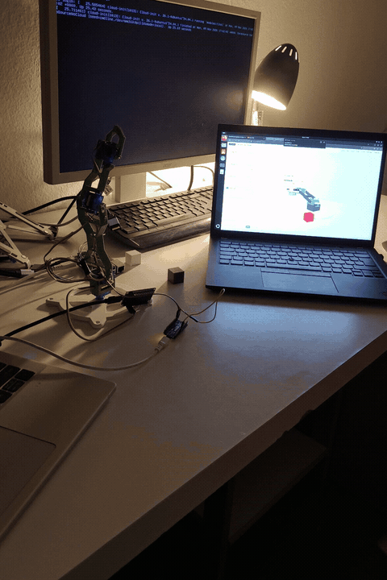
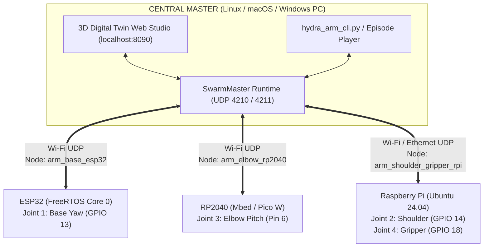

# OpenSwarm HydraArm — Multi-Controller Distributed Robotic Arm

<p align="center">
  <a href="https://pypi.org/project/openswarm-master/"></a>
  <a href="https://pypi.org/project/openswarm-slave/"></a>
  <a href="https://github.com/raihhann/OpenSwarm"></a>
  
  
</p>

> **One Robot. Three Different Controller Architectures. Zero Slave Control Logic.**  
> **HydraArm** is a 4-DOF distributed robotic arm powered by [**OpenSwarm**](https://github.com/raihhann/OpenSwarm), where each joint is driven by a different microcontroller or SBC over Wi-Fi UDP (`ESP32` + `RP2040` + `Raspberry Pi Ubuntu 24.04`), while a central Python Master runs 100% of the kinematics, synchronization, episode playback, and an interactive **3D Digital Twin Web Studio**.

---

## Live Hardware Demo & Setup

<p align="center">
  <a href="Demo.mp4">
    
  </a>
  &nbsp;&nbsp;&nbsp;
  
  <br />
  <em>Left: Live 3-controller pick-and-place execution (<a href="Demo.mp4">click to open full <code>Demo.mp4</code></a>). Right: Physical arm wired to ESP32, RP2040, and Raspberry Pi alongside the live 3D Digital Twin Studio.</em>
</p>

---

## What HydraArm Is Based On

* **Mechanical 3D-Printed Hardware:** Based on the [**Servo Mini Arm by Luca Dilo**](https://makerworld.com/en/models/1290483-servo-mini-arm), a compact 4-DOF arm designed for four SG90 / MG90S 9g micro servos.
* **Distributed Control Architecture:** Powered by [**OpenSwarm**](https://github.com/raihhann/OpenSwarm) (`openswarm-master`, `openswarm-slave`, and the Arduino/PlatformIO `SwarmNode` library).
* **Repository Relationship:** This repository is maintained as a standalone project so it can be cloned, studied, and deployed independently, and is also mirrored as a showcase inside the main OpenSwarm repository (`projects/hydra_arm/`).

### Key Capabilities
1. **Heterogeneous Multi-Controller Execution:** Splits a single 4-DOF manipulator across **3 distinct CPU architectures** (`Xtensa ESP32`, `ARM Cortex-M0+ RP2040`, and `ARM Cortex-A Raspberry Pi`).
2. **Zero Control Logic on Slaves:** Every microcontroller sketch has an **empty `void loop()`**—nodes only declare their Wi-Fi credentials and servo pin in `setup()`.
3. **Synchronized Multi-Node Actuation:** Uses OpenSwarm's 15-bit modular clock-scheduled actuation (`at_ms`) and monotonic sequence numbers (`seq`/`ack`) so all joints move together cleanly despite Wi-Fi jitter.
4. **3D Digital Twin Web Studio & CLI:** Click any servo on the 3D arm in your browser (`localhost:8090`) to drag its slider and actuate the physical joint in real time, or record/replay JSON motion episodes.

---

## System Architecture



---

## 1. Wiring & Pinout Guide

Each SG90 / MG90S servo has 3 wires:
* **Orange / Yellow:** PWM Signal
* **Red:** `+5V` Power (`VIN` / `VBUS` / external regulated 5V 2A supply recommended)
* **Brown / Black:** `GND` *(Must share a common ground across all controllers and the 5V supply!)*

| Joint | Role | Controller | Slave Node ID | Actuator Name | Signal Pin | Power (`+5V`) | Ground (`GND`) | Firmware / Script |
| :--- | :--- | :--- | :--- | :--- | :--- | :--- | :--- | :--- |
| **Joint 1: Base Yaw** | Rotates base (`0°–180°`, Home `90°`) | **ESP32** | `arm_base_esp32` | `servo` | **GPIO 13** (`D13`) | `5V` / `VIN` | `GND` | [`esp32_base_node.ino`](./slaves/esp32_base_node/esp32_base_node.ino) |
| **Joint 2: Shoulder Pitch** | Tilts vertical link (`20°–160°`, Home `140°`) | **Raspberry Pi** *(Ubuntu 24.04)* | `arm_shoulder_gripper_rpi` | `shoulder_servo` | **BCM GPIO 14** *(Pin 8)* | **Pin 2** (`5V`) | **Pin 6** (`GND`) | [`rpi_shoulder_gripper_node.py`](./slaves/rpi_shoulder_gripper_node/rpi_shoulder_gripper_node.py) |
| **Joint 3: Elbow Pitch** | Raises/lowers forearm (`20°–160°`, Home `90°`) | **RP2040** *(Nano RP2040 / Pico W)* | `arm_elbow_rp2040` | `servo` | **Pin 6** (`D6` / `GP6`) | `VBUS` (`5V`) | `GND` | [`rp2040_elbow_node.ino`](./slaves/rp2040_elbow_node/rp2040_elbow_node.ino) |
| **Joint 4: Gripper Claw** | Opens/closes jaws (`10°–95°`, Home `45°`) | **Raspberry Pi** *(Ubuntu 24.04)* | `arm_shoulder_gripper_rpi` | `gripper_servo` | **BCM GPIO 18** *(Pin 12)* | **Pin 4** (`5V`) | **Pin 14** (`GND`) | [`rpi_shoulder_gripper_node.py`](./slaves/rpi_shoulder_gripper_node/rpi_shoulder_gripper_node.py) |

### Raspberry Pi 40-Pin Header Quick Map (Outer Even Row)
* **Pin 2 (`5V`)** &rarr; Shoulder Servo Red (`+5V`)
* **Pin 4 (`5V`)** &rarr; Gripper Servo Red (`+5V`)
* **Pin 6 (`GND`)** &rarr; Shoulder Servo Brown/Black (`GND`)
* **Pin 8 (`BCM 14`)** &rarr; Shoulder Servo Orange/Yellow (`Signal`)
* **Pin 12 (`BCM 18`)** &rarr; Gripper Servo Orange/Yellow (`Signal`)
* **Pin 14 (`GND`)** &rarr; Gripper Servo Brown/Black (`GND`)

---

## 2. Setting Up Each Slave Controller

### A. Joint 1 — ESP32 (`arm_base_esp32`)
1. Install **`SwarmNode`** in Arduino IDE (**Tools &rarr; Manage Libraries... &rarr; `SwarmNode`**) or PlatformIO (`raihann/SwarmNode`).
2. Open [`slaves/esp32_base_node/esp32_base_node.ino`](./slaves/esp32_base_node/esp32_base_node.ino).
3. Enter your `WIFI_SSID` and `WIFI_PASS` and flash the ESP32.

### B. Joint 3 — RP2040 (`arm_elbow_rp2040`)
1. Open [`slaves/rp2040_elbow_node/rp2040_elbow_node.ino`](./slaves/rp2040_elbow_node/rp2040_elbow_node.ino) in Arduino IDE.
2. Enter your `WIFI_SSID` and `WIFI_PASS` and upload to your Nano RP2040 Connect or Pico W.

### C. Joints 2 & 4 — Raspberry Pi Ubuntu 24.04 (`arm_shoulder_gripper_rpi`)
SSH into your Raspberry Pi and run:
```bash
sudo apt update
sudo apt install -y python3 python3-pip python3-lgpio python3-rpi-lgpio git
sudo python3 -m pip install --break-system-packages --upgrade openswarm-slave

cd slaves/rpi_shoulder_gripper_node
sudo python3 rpi_shoulder_gripper_node.py
```

---

## 3. Running HydraArm on Your Master PC

### Installation
```bash
git clone https://github.com/raihhann/OpenSwarm-HydraArm.git
cd OpenSwarm-HydraArm
pip install -r requirements.txt
```

### Option A: Interactive 3D Digital Twin Studio
```bash
python master/hydra_arm_studio.py
```
Open **`http://localhost:8090`** in your browser:
* Click directly on any of the 4 blue SG90 servos on the 3D arm (or its floating label).
* Drag the floating slider popup to move both the 3D digital twin and the physical joint in real time.

> [!TIP]
> Want to test the 3D Studio without physical boards? Run `python master/virtual_arm_slaves.py` in a second terminal to spin up protocol-compatible virtual ESP32, RP2040, and Raspberry Pi nodes on localhost.

### Option B: Interactive Terminal CLI
```bash
python master/hydra_arm_cli.py
```
Example commands:
```text
hydra> status
hydra> base 120
hydra> shoulder 140
hydra> elbow 75
hydra> gripper 20
hydra> pose 90 125 65 85
hydra> home
hydra> demo
```

### Option C: Replay Pre-Recorded Episodes
```bash
python master/hydra_arm_episodes.py episodes/demo_pick_and_place.json
```

---

## Repository Structure

```text
OpenSwarm-HydraArm/
├── assets/
│   ├── demo_hydra_arm.gif          # Animated hardware demo
│   └── hydra_arm_setup.jpg         # Bench setup + 3D Studio photo
├── episodes/
│   ├── demo_pick_and_place.json    # Sample pick-and-place trajectory
│   ├── ep.json
│   ├── episode_1.json
│   └── episode_2.json
├── master/
│   ├── hydra_arm_studio.py         # 3D Digital Twin Web Studio (port 8090)
│   ├── hydra_arm_cli.py            # Interactive terminal controller
│   ├── hydra_arm_episodes.py       # Episode validation & playback
│   ├── hydra_arm_model.py          # Shared joint limits & kinematics model
│   └── virtual_arm_slaves.py       # Hardware-free virtual 3-node emulator
├── slaves/
│   ├── esp32_base_node/            # ESP32 firmware (Joint 1)
│   ├── rp2040_elbow_node/          # RP2040 firmware (Joint 3)
│   └── rpi_shoulder_gripper_node/  # Raspberry Pi agent (Joints 2 & 4)
├── Demo.mp4                        # Full hardware demonstration video
├── requirements.txt
├── LICENSE
└── README.md
```

---

## Credits & License

* **Mechanical CAD Design:** [Servo Mini Arm by Luca Dilo](https://makerworld.com/en/models/1290483-servo-mini-arm)
* **Distributed Framework:** [OpenSwarm](https://github.com/raihhann/OpenSwarm) by **Mohammed Raihan Soniwala**
* **License:** Released under the [MIT License](LICENSE).
